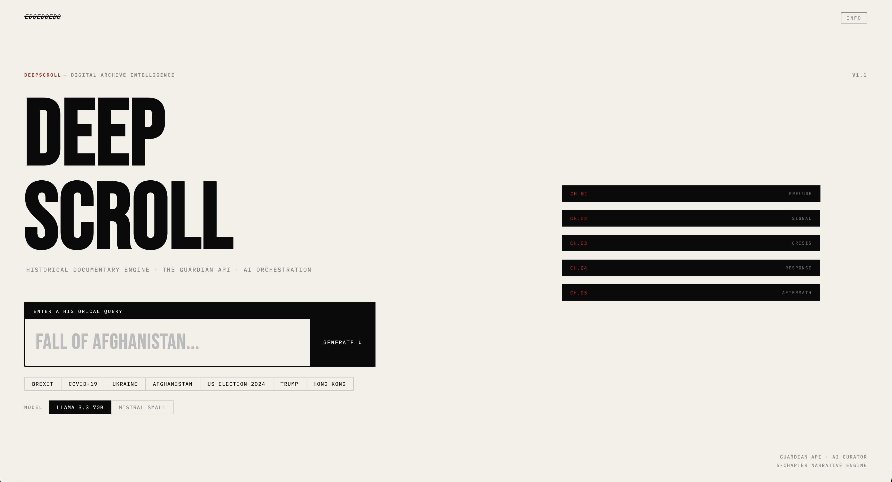

# DEEPSCROLL



**Historical Documentary Engine**
The Guardian API · AI Orchestration · Scrollytelling

**[→ Live Demo](https://deepscroll.edoedoedo.it/)**

---

### The premise is simple.

You type a historical query. The AI doesn't write about it — it *excavates* it. It designs a 5-act narrative arc, searches The Guardian's archive of over two million articles, scores and ranks the results, and renders them into an interactive scrollytelling documentary.

Every headline is real. Every excerpt is real. Every source is attributed. The AI is the director and the narrator. The Guardian is the author.

---

### How it works

```
User query
    │
    ▼
LLM · one call (GPT-OSS 120B on Groq · Mistral Small 4 fallback)
    │ → 5-act arc: keyword, date window, focal date, section per act
    │ → voiceover per act, subtitle, 2 interludes
    ▼
Guardian Content API × 5 (throttled, cached)
    │ → 20 articles per act, bodyText excerpts
    │ → section / topic fallback if a window is empty
    ▼
Scorer v3 → hero per act, never the same article twice
    │ → Relevance 35% · Date proximity 25% · Tone 20%
    │ → Narrative density 10% · Media 10%
    ▼
NDJSON stream → live log → 5-act scrollytelling documentary
```

One LLM call per documentary (about 2–3k tokens), so it runs comfortably on the free tiers of Groq and Mistral. The pipeline runs server-side in one streamed request (`POST /api/documentary`): the browser receives log, plan and per-chapter events as they happen, so the loading screen shows the real work.

The call asks for JSON Schema structured output. Models are called through the providers' OpenAI-compatible endpoints with plain `fetch`: no SDK to break, and swapping a model is a one-line change. On a free-tier rate limit (429) the server waits the few seconds the provider asks for and retries; if a provider is down, the other one takes over.

The LLM call and the Guardian searches are cached through Next's data cache, so a repeated query costs nothing. The preset queries can also be pre-generated as static files (see *Presets*).

---

### The 5-act structure

Every documentary follows a fixed dramatic arc:

| Act | Tag | Role |
|-----|-----|------|
| 01 | **Prelude** | The world before. Systemic blindness, false normalcy. |
| 02 | **Signal** | The first crack nobody wanted to see. |
| 03 | **Crisis** | The breaking point. Maximum impact. |
| 04 | **Response** | How the system reacts. Bailouts, decisions, mobilization. |
| 05 | **Aftermath** | The bill comes due. What changed, what didn't. |

This is not a timeline. It's a dramaturgy. The difference matters: "2007, 2008, 2009" tells you dates. "Blindness → Signal → Collapse → Rescue → Reckoning" tells you a story.

---

### Design philosophy

**Brutalist, not decorative.** The interface exposes its own machinery — scorer breakdowns, word counts, section tags, article IDs. Metadata is not hidden; it's an aesthetic choice.

**AI as curator, not author.** The intelligence layer organizes real journalism into narrative structure: it chooses the moments and writes the voiceover, while headlines, excerpts and sources are real Guardian copy, attributed and linked in every act.

**Scroll as excavation.** The scroll is not navigation — it's the act of digging through collective digital memory. The depth bar tracks your progress. The strata index under each act lists the other articles from that window. The interludes force you to pause.

**Each act looks like its role.** Prelude is calm. Signal mirrors the layout and a red crack opens as you scroll. Crisis is a full-bleed pinned stage. Response is dense. Aftermath is a single quiet column.

---

### Stack

| Layer | Technology |
|-------|-----------|
| Framework | Next.js 15 · TypeScript strict |
| AI | Groq (GPT-OSS 120B) · Mistral (Small 4) · JSON Schema structured output · plain fetch |
| Data | The Guardian Content API |
| Animations | GSAP · ScrollTrigger |
| Styling | Vanilla CSS · Brutalist design system |
| Fonts | Bebas Neue · Barlow Condensed · IBM Plex Mono · DM Serif Display (next/font) |
| Deploy | Vercel |

---

### Setup

```bash
git clone https://github.com/EdoEdoEdo/DeepScroll.git
cd deepscroll
npm install
```

Create `.env.local` from `.env.example`:

```env
# At least one LLM required — with both, the second is an automatic fallback
GROQ_API_KEY=           # https://console.groq.com/keys
MISTRAL_API_KEY=        # https://console.mistral.ai/api-keys

# Required
GUARDIAN_API_KEY=       # https://open-platform.theguardian.com/access/

# Optional
GUARDIAN_MAX_RPS=1      # Guardian requests/second (recent developer keys: 1/s, 500/day)
RATE_LIMIT_PER_10MIN=12 # documentaries per IP per 10 min, production only
```

```bash
npm run dev
```

Visit `http://localhost:3000/api/health` to verify your keys — it checks that each configured model is actually listed by its provider, so a retired model shows up here — then `http://localhost:3000` to start.

---

### Presets

The landing presets can be pre-generated as static files, so they load instantly, cost no API quota and keep working even if every LLM provider is down:

```bash
npm run dev        # terminal 1
npm run presets    # terminal 2 → writes public/presets/<slug>.json
```

Commit the generated files. They are versioned: when the data shape changes, stale files are ignored until you regenerate them. The preset list lives in `app/utils/presets.json`.

---

### Changing or adding a model

Models live in `MODEL_OPTIONS` in `app/utils/llm.ts`:

```typescript
{
  id: "groq-gpt-oss-120b",        // stable ID used by the UI
  label: "GPT-OSS 120B",
  provider: "groq",
  modelId: "openai/gpt-oss-120b", // provider model string
}
```

- **Swap a model:** change `modelId`. Pin dated snapshots (e.g. `mistral-small-2603`), not `-latest` aliases.
- **New OpenAI-compatible provider:** add it to `PROVIDERS` (env key, chat URL, models URL) and to `ProviderId`.

The model switch appears automatically in the UI when more than one key is configured.

---

### Routes

| Route | Purpose |
|-------|---------|
| `/` | Full documentary experience · `/?q=Brexit` opens a documentary directly (shareable) |
| `/dev` | Diagnostic — health, Guardian + scorer, arc |
| `/api/documentary` | POST `{ query, model? }` → NDJSON stream of pipeline events + result |
| `/api/health` | Real checks: Guardian request, provider key + model availability |
| `/api/models` | Available models based on configured keys |
| `/api/guardian?q=...` | Guardian search + scorer (diagnostic) |
| `/api/guardian/article?id=...` | Single article for the overlay (sanitized) |
| `/api/orchestrate` | POST `{ query, model? }` → arc only, the LLM call (diagnostic) |

---

### Project structure

```
app/
├── api/
│   ├── documentary/route.ts      # Full pipeline, NDJSON stream
│   ├── guardian/
│   │   ├── route.ts              # Search + scorer (diagnostic)
│   │   └── article/route.ts      # Single article for the overlay
│   ├── orchestrate/route.ts      # Arc only (diagnostic)
│   ├── models/route.ts           # Available models endpoint
│   └── health/route.ts           # Real connectivity + model checks
├── components/
│   ├── QueryScreen.tsx           # Landing — input, presets, model switch, info
│   ├── ArchStrata.tsx            # Landing — magnetic strata bars
│   ├── LoadingScreen.tsx         # Live log + strata filling per act
│   ├── DocHeader.tsx             # Documentary header with real stats
│   ├── Chapter.tsx               # One act — per-act layout and motion
│   ├── SourceStrata.tsx          # Index of the other articles in the window
│   ├── GuardianBox.tsx           # Source attribution with read-more
│   ├── AIBlock.tsx               # Coverage analysis, word-by-word reveal
│   ├── Interlude.tsx             # Red interlude cards
│   ├── DepthIndicator.tsx        # Scroll bar + chapter indicator
│   ├── Finale.tsx                # Stats, primary sources, share link
│   ├── ArticleOverlay.tsx        # Full article reading modal
│   └── InfoModal.tsx             # Project info overlay
├── utils/
│   ├── documentary.ts            # Server pipeline (arc → retrieve → rank)
│   ├── llm.ts                    # Groq/Mistral via fetch, structured output, 429 retry, fallback
│   ├── prompts.ts                # Prompt + JSON Schema of the LLM call
│   ├── guardian-client.ts        # Throttled, cached Guardian client
│   ├── scorer.ts                 # Article ranking v3
│   ├── pipeline.ts               # Client runner — presets or NDJSON stream
│   ├── rate-limit.ts             # Best-effort per-IP limiter
│   ├── arc.ts                    # Narrative constants, presets, versions
│   ├── presets.json              # Landing presets (shared with the script)
│   ├── types.ts                  # All TypeScript interfaces
│   ├── text.ts                   # HTML stripping/sanitizing, image extraction
│   └── gsap.ts                   # GSAP + ScrollTrigger registration
├── dev/page.tsx                  # Diagnostic page
├── globals.css                   # Brutalist design system
├── layout.tsx                    # Root layout, fonts, metadata
└── page.tsx                      # State machine, shareable ?q=
scripts/generate-presets.mjs      # Pre-generate presets into public/presets
```

---

### Animations

All scroll animations use GSAP + ScrollTrigger:

- **Headlines** — clip-path reveal from bottom
- **Crisis stage** — pinned full-bleed image, scale 1.18 → 1 with the headline rising (desktop)
- **Signal crack** — red line drawn with scroll scrub
- **Images** — parallax ±40px on scroll
- **Strata index** — rows staggered in
- **Guardian Box** — slide in from left
- **Metadata rows** — stagger at 60ms intervals
- **AI Block** — word-by-word typing effect
- **Interludes** — scale entrance from 0.97
- **DocHeader** — sequenced timeline
- **Finale** — staggered stats and sources
- **Loading** — strata bars fill as each act is retrieved

---

### What DeepScroll is not

- Not a news aggregator
- Not a chatbot
- Not a search engine
- Not a content generator — the journalism is The Guardian's; the AI only directs and narrates
- Not a timeline — it's a dramaturgy

---

**Built by [edoedoedo.it](https://edoedoedo.it)**
